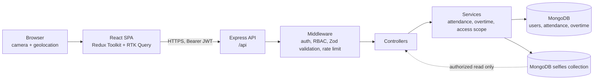

<div align="center">


<br>


[Live app](https://attendance-management-iota-two.vercel.app/) · [Backend](https://attendance-management-3ye0.onrender.com/) · [Source](https://github.com/Siddhant963/Attendance_Management) · [Design reference](https://stitch.withgoogle.com/projects/16927878864864845580)

</div>

---

## Overview

AttendFlow is a MERN attendance management system. Employees punch in and out with a live camera selfie and browser location, request overtime for a completed day, and see their own history. Managers and admins verify attendance, approve overtime and read daily reports for the people in their scope.

There are three roles: **Employee**, **Manager** and **Admin**. The frontend and backend are separate services, deployed at the links above. The deployed workflows have not been re-verified as part of this README; see [Deployment](#deployment).

| Resource | Link |
| --- | --- |
| Frontend (Vercel) | https://attendance-management-iota-two.vercel.app/ |
| Backend API (Render) | https://attendance-management-3ye0.onrender.com/api/health |
| Repository | https://github.com/Siddhant963/Attendance_Management |
| Design reference | [Google Stitch project](https://stitch.withgoogle.com/projects/16927878864864845580) |

## Preview

The repository does not contain application screenshots. The intended visual design (the "Executive Precision" system, with light and dark themes) is in the [Stitch project](https://stitch.withgoogle.com/projects/16927878864864845580). Those are design mockups, not captures of the running app.

## Features

**Authentication and role-based access**
- Email and password signup and login (bcrypt hashing, JWT bearer tokens), with rate limiting on both routes.
- Role checks on frontend routes and on every backend route; the server is the source of truth.
- Admins can disable accounts; a disabled user's token stops working immediately.

**Attendance capture**
- Punch in and out with a selfie taken from the live camera (`getUserMedia`, no file upload) and the browser's geolocation.
- One record per user per day, enforced by a unique index; concurrent punches cannot create duplicates.

**Working hours**
- Hours are computed on the server from stored timestamps. 8 hours or more is *Completed*, less is *Incomplete*, and punched in only is *In progress*.

**Overtime workflow**
- Employees request overtime against a punched-out day (one request per day).
- A manager or admin approves or rejects; rejection requires a remark. The result is written to the attendance record.

**Attendance verification**
- Managers and admins mark a record *Valid* or *Invalid* (a remark is required for invalid) and can add notes. Reviewers cannot verify or approve their own records.

**Administration and reports**
- Role-specific dashboards, a daily report (own, team or all), filters with pagination, and a print-friendly report layout.
- Admin Users page: change roles, assign managers, activate or disable accounts.
- Light and dark themes.

**Not implemented:** geofencing, notifications, real-time updates, face matching, PDF or Excel export.

## Role Permissions

| Capability | Employee | Manager | Admin |
| --- | :---: | :---: | :---: |
| Sign up (always creates an Employee) | ✔ | ✔ | ✔ |
| Punch in / out, view own attendance | ✔ | ✔ | ✔ |
| Request overtime for own days | ✔ | ✔ | ✔ |
| Daily report and dashboard | Own | Team | Everyone |
| View attendance and selfies of others | — | Assigned team | Everyone |
| Verify attendance | — | Team | Everyone |
| Approve / reject overtime | — | Team | Everyone |
| Review own records | — | — | — |
| Manage users (roles, manager, active status) | — | — | ✔ |

A manager's own records are reviewed by an admin. Verified against `backend/src/routes/index.js`, `backend/src/services/scopeService.js` and `frontend/src/App.jsx`.

## Technology Stack

| Area | Technology |
| --- | --- |
| Frontend | React 19, Vite, React Router |
| State and API | Redux Toolkit, RTK Query |
| Backend | Node.js, Express 5, JWT, bcryptjs, Helmet, CORS, express-rate-limit |
| Database | MongoDB with Mongoose |
| Validation and logging | Zod, Winston, Morgan |
| Testing | Node's built-in test runner, Supertest, mongodb-memory-server |

## Architecture



- Selfies are stored as binary documents in a separate `selfies` collection of the same database. They are never served statically; the selfie endpoint checks the caller's access first, and the UI fetches them with the bearer token.
- Every attendance, selfie, report and overtime query is filtered through `scopeService`, which limits employees to themselves, managers to their assigned team and admins to everyone.
- `backend/src/utils/selfieStorage.js` is the only file that touches selfie storage, so it can be replaced if volume outgrows MongoDB.

## Project Structure

```text
.
├── backend
│   ├── src
│   │   ├── config/        env, Winston logger, database connection
│   │   ├── controllers/   thin HTTP layer
│   │   ├── middleware/    authenticate / authorize, validation, error handler
│   │   ├── models/        User, Attendance, OvertimeRequest, Selfie
│   │   ├── routes/        route table with per-route role guards
│   │   ├── seed/          local demo-account seed
│   │   ├── services/      attendance, overtime, access scope
│   │   ├── utils/         selfie storage, business-date helper, ApiError
│   │   ├── validators.js  Zod request schemas
│   │   ├── app.js
│   │   └── server.js
│   └── tests/             api, cors, seed, selfie tests
├── frontend
│   ├── src
│   │   ├── api/           RTK Query base API and endpoints
│   │   ├── app/           Redux store
│   │   ├── components/    layout, route guards, camera capture, tables
│   │   ├── features/auth/ auth slice
│   │   ├── hooks/         geolocation, theme
│   │   ├── pages/         one file per screen group
│   │   └── main.jsx
│   └── vercel.json        SPA rewrite
└── docs/assets            README banner
```

## Local Setup

**Prerequisites:** Node.js 20.19 or newer, npm, and a MongoDB database (local or Atlas).

**1. Backend**

```bash
cd backend
cp .env.example .env        # PowerShell: Copy-Item .env.example .env
npm install
```

Edit `backend/.env`: set `MONGODB_URI` and replace `JWT_SECRET` with a long random string. Keep this file local; it is git-ignored.

Optional, for local evaluation only: create demo accounts (see [Demo Environment and Security](#demo-environment-and-security)).

```bash
npm run seed
npm run dev                 # http://localhost:5000
```

**2. Frontend** (second terminal)

```bash
cd frontend
npm install
npm run dev                 # http://localhost:5173, proxies /api to localhost:5000
```

**Production build**

```bash
cd frontend && npm run build    # output in frontend/dist
cd backend && npm start         # serves the API only
```

Camera and location access require HTTPS or `localhost`.

## Environment Variables

**Backend** (`backend/.env`, template in `backend/.env.example`)

| Variable | Purpose | Required | Example |
| --- | --- | --- | --- |
| `MONGODB_URI` | MongoDB connection string; selfies are stored in the same database | Yes | `mongodb+srv://<user>:<password>@<cluster>/<db>` |
| `JWT_SECRET` | Signing key for access tokens | Yes | `<long-random-string>` |
| `CLIENT_ORIGIN` | Comma-separated allowed frontend origins, no trailing slash. Defaults to `http://localhost:5173`, so a deployed frontend is blocked by CORS until this is set | In production | `https://<your-frontend-host>` |
| `NODE_ENV` | `production` hides internal error messages, uses combined request logs and blocks the demo seed | In production | `production` |
| `PORT` | HTTP port (default `5000`; hosts such as Render provide it) | No | `5000` |
| `JWT_EXPIRES_IN` | Token lifetime (default `1d`) | No | `1d` |
| `APP_TIMEZONE` | Business timezone for attendance days (default `Asia/Kolkata`) | No | `Asia/Kolkata` |
| `DNS_SERVERS` | Custom DNS servers, only if a `mongodb+srv://` URI fails with `querySrv ECONNREFUSED` | No | `1.1.1.1,8.8.8.8` |
| `ALLOW_DEMO_SEED` | Read only by `npm run seed`; lets it run with `NODE_ENV=production` | No | `true` |

**Frontend** (`frontend/.env`; Vite reads these at **build time**)

| Variable | Purpose | Required | Example |
| --- | --- | --- | --- |
| `VITE_API_URL` | Deployed backend API URL, ending in `/api`. Leave unset in development | In production | `https://<your-backend-host>/api` |
| `VITE_SHOW_DEMO` | Shows the demo-login helper only when exactly `true` | No | `false` |

In production, set secrets in the hosting provider's environment settings, never in committed files.

## API Overview

All routes are under `/api`. Everything except `/health`, `/auth/signup` and `/auth/login` requires `Authorization: Bearer <token>`. Request bodies and queries are validated with Zod.

| Method and path | Access | Purpose |
| --- | --- | --- |
| `GET /health` | Public | Health check |
| `POST /auth/signup`, `POST /auth/login` | Public, rate limited | Create an employee account; sign in |
| `GET /auth/me` | Any signed-in user | Current user |
| `POST /attendance/punch-in`, `/punch-out` | Any role | Punch with selfie and location |
| `GET /attendance/current`, `/attendance/me` | Any role | Own current record and history |
| `GET /attendance` | Manager, Admin | Scoped attendance list with filters |
| `GET /attendance/:id`, `/attendance/:id/selfie/:kind` | Owner, or reviewer in scope | Record detail; selfie (`in` or `out`) |
| `PATCH /attendance/:id/verification` | Manager, Admin | Mark Valid or Invalid with remark |
| `POST /overtime`, `GET /overtime/me` | Any role | Request overtime; list own requests |
| `GET /overtime` | Manager, Admin | Scoped overtime requests |
| `PATCH /overtime/:id/decision` | Manager, Admin | Approve or reject |
| `GET /users`, `/users/managers`, `PATCH /users/:id` | Admin | List users and managers; change role, manager, status |
| `GET /users/options` | Manager, Admin | Users available for report and list filters |
| `GET /reports/daily` | Any role, scoped | Daily report |
| `GET /dashboard/summary` | Any role, scoped | Role-specific dashboard figures |

## Testing and Quality

```bash
cd backend && npm test          # node --test, in-memory MongoDB (downloaded on first run)
cd frontend && npm run build    # production build check
```

At the time of writing, the backend suite ran 36 tests with 0 failures and the frontend production build succeeded. Re-run both for current results; there is no CI badge because no CI is configured.

Automated tests cover the API, CORS, seeding and selfie storage. There is no frontend test suite. Camera and location behavior was exercised in a browser with a fake camera and emulated location, not on physical devices.

## Deployment

The frontend and backend are separate services.

- **Database:** MongoDB Atlas or any persistent MongoDB. Create a database user and allow the backend host's outbound IPs.
- **Backend (Render or similar, Node 20.19+):** root directory `backend`, build `npm ci --omit=dev`, start `npm start`, health check `/api/health`. Set `NODE_ENV`, `MONGODB_URI`, `JWT_SECRET` and `CLIENT_ORIGIN` (the frontend's exact origin).
- **Frontend (Vercel):** root directory `frontend`, Vite preset (`npm run build`, output `dist`). Set `VITE_API_URL` and `VITE_SHOW_DEMO=false` before building. `frontend/vercel.json` rewrites every path except `/api/...` to `index.html`, so deep links such as `/dashboard` survive a refresh.
- **First administrator:** the demo seed is blocked in production and signup only creates employees, so promote one account directly in the database, for example `db.users.updateOne({ email: "you@example.com" }, { $set: { role: "admin" } })`. That admin assigns all other roles from the Users page.

**Known limitation:** this README does not certify the state of the live deployment. End-to-end flows there (including camera and location on real devices) should be checked after each deploy.

## Demo Environment and Security

- `npm run seed` creates one demo account per role and prints the sign-in details in your terminal when it finishes. Credentials are intentionally not published here.
- The demo admin is a real administrator. **Never seed demo accounts into a database that holds real users.** The seed refuses to run when `NODE_ENV=production` unless `ALLOW_DEMO_SEED=true`.
- To offer demo logins to evaluators, run a separate environment: its own database, `JWT_SECRET` and backend, plus a frontend built with `VITE_SHOW_DEMO=true`. Use synthetic data only and drop the database afterwards.
- The demo-login helper only pre-fills the form. Hiding it is a convenience, not a security control.
- Public signup always creates an employee; only an admin can change roles. Authentication and authorization are enforced on the server for every protected route.

## Assumptions and Limitations

- Attendance days are calendar days in `APP_TIMEZONE`. A user with an unclosed record from an earlier day must punch out of it before punching in again.
- Selfies are reviewed by people. The app makes no biometric or face-matching claims, and there is no geofencing: location is recorded, not validated.
- Managers are linked to employees by an admin.
- The daily report lists recorded attendance and does not infer absences.
- Tokens are kept in `localStorage`. There are no refresh tokens or revocation beyond disabling the account, and rate limiting is per backend instance.
- Each selfie is capped at 1.5 MB and stored in MongoDB; watch database size on small Atlas tiers.
- Selfies from the earlier disk-based version were not migrated and show as unavailable. New deployments should start from an empty database.

## Design Reference and Acknowledgments

The UI follows the "Executive Precision" design direction prepared in [Google Stitch](https://stitch.withgoogle.com/projects/16927878864864845580).

## License

No license file is included in this repository.
